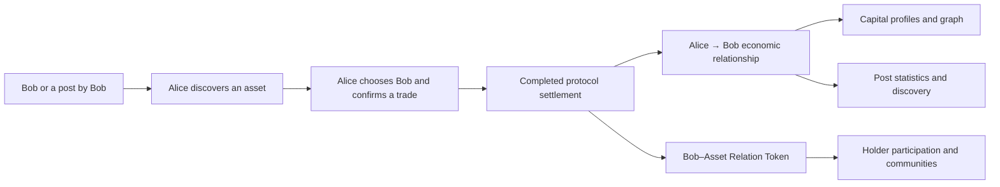

# MoonShip

**An open onchain network of capital influence and economic relationships, and a platform for discovering people and information through capital.**

[Web app](https://app.moonship.online/app/) · [中文说明](README.zh-CN.md) · [Development updates](UPDATES.md)

Clients: native iOS in development distribution and a restored browser application.
The web entry and existing mainnet/testnet services were reachable during the latest
read-only check. App Store release and broader user acceptance remain separate;
the standalone extension remains retired.

## Current progress — 25 October 2026

Homepage reads now return text while updating in the background. The native cache update is installed; user acceptance remains separate.

- Mobile spot trading has streamlined native confirmation and separate delivery, network-finality and protocol-settlement states. A small real spot order completed delivery and settlement; this is engineering acceptance, not evidence of market traction.
- Capital discovery and chat backend corrections are live. Profile loading and relationship-token/network views have further local improvements; multi-user acceptance remains separate.
- An issuance-policy update is implemented privately and has passed local checks and migration rehearsal. Onchain activation, finality and hosted migration are verified. Existing fees and historical income claims are retained.
- Native perpetual trading and its separate fee component retain their previously recorded release stages. The additional integrated funding path is locally implemented and not enabled in the current public configuration.
- Development builds are installed locally. Broader beta distribution, complete user funding/exit/chat acceptance, and independent security review are not established by these milestones.

See the [dated release notes](UPDATES.md) and [implementation status](docs/IMPLEMENTATION_STATUS.md). Fees and issuance ideas discussed during product design are not live policies unless explicitly recorded as activated.

> **Public repository scope — 17 October 2026**
>
> MoonShip's core functionality has been implemented. To protect project intellectual property and sensitive operational details, the core implementation is now maintained in the private [MoonShipLab](https://github.com/Conor-711/MoonShipLab) repository. This public repository intentionally contains only a project overview, implementation-status descriptions, diagrams, brand assets and selected presentation-layer source. It is not the complete implementation or a deployable copy of MoonShip.
>
> A feature marked **implemented / private source** below refers to an implementation maintained privately; its source is intentionally omitted here. This distinction is important when reviewing the project. Implementation descriptions are maintainer statements; independent code review and a security audit are separate activities.

## What we are building

1. **A network that makes people's capital influence and their economic relationships visible.** Profiles and graphs show who acts through whom, the capital involved, and the relationships created by completed economic activity.
2. **An open platform where capital helps discover people and information, and contributors to discovery can be rewarded.** People can discover posts and sources through economic activity, act from that source, and participate through Relation Tokens, received-fee income and holder communities.

## The primitive

**Alice chooses Bob as the source for an asset purchase. The completed trade connects Alice and Bob.**

Posts are part of their author's economic relationships. Starting from a post or from its author uses the same subject attribution and Relation Token flow; the post adds its own statistics. A source selection records the trader's explicit choice.

## Implemented product areas

| Area | Current implementation | Source in this repository |
| --- | --- | --- |
| Protocol | Subject identities, attributed settlement, relationship records, Relation Tokens and received-fee accounting | Summary only; core implementation private |
| iOS client | Native profiles, feeds, holdings, wallet and income views with protocol integration; compatible development build installed | Summary only; client source private |
| Web application | Restored alongside iOS; public entry available, with hosted availability and user-flow acceptance recorded separately | Summary only; full source private |
| Historical X extension | Retired standalone targets; selected presentation excerpts retained for context | Selected historical visual source only |
| Discover | Capital-driven native/settled-X feed, public post traders, people / post rankings and author archives | Summary only; application and indexing implementation private |
| Relationship benefits | Direct messages, amount- or rank-gated holder groups and holder-only opportunity sharing | Summary only; access and service implementation private |
| Environments | Configured Monad / Ethereum paths, additional EVM routes for registered assets, and separate testing environments | Runtime setup and operations private |

Read [implementation status](docs/IMPLEMENTATION_STATUS.md), [the product overview](docs/PRODUCT_OVERVIEW.md), and [the source boundary](SOURCE_SCOPE.md).

## What is available here

- `frontend/`: selected existing UI icons and styles, with original source paths and hashes.
- `assets/`: the project's existing brand artwork.
- `docs/`: product behavior and implementation-status summaries, without core mechanism code.

The full application depends on private packages and services, so these excerpts do not provide a standalone build. No stub contract, mock backend or fabricated implementation is presented as the actual protocol.

## Reviewing MoonShip

The iOS client currently uses development distribution. Full-source review requires the owner's explicit access grant to the private repository; a private repository returning 404 without that grant is expected. Please contact the project owner through the existing submission or collaboration channel to arrange a review.

The omission of source here does not establish independent correctness, product adoption, revenue or a completed security audit. This repository contains no claim of external user counts, fundraising or guaranteed returns.
