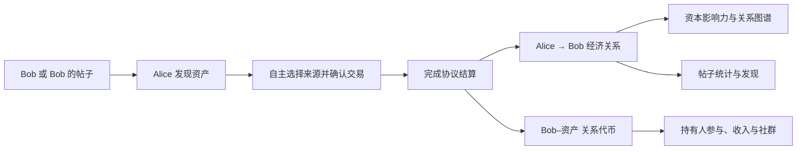

# MoonShip

**展示人的资本影响力与人与人经济关系的链上开放网络；用资本发现人和信息，并奖励发现力贡献者的开放平台。**

[官网](https://www.moonship.online/) · [网页应用](https://app.moonship.online/app/) · [Chrome 插件](https://chromewebstore.google.com/detail/nibgedjlfnhdmefhieibfiebmakdoegl) · [English](README.md)

> **公开仓库范围说明｜2026 年 10 月 17 日**
>
> **MoonShip 的核心功能已经实现。出于隐私、敏感运营信息和项目知识产权保护的考虑，核心实现已转入私有仓库 [MoonShipLab](https://github.com/Conor-711/MoonShipLab)。本公开仓库仅展示部分内容：项目介绍、实现状态、图示、品牌素材及精选 UI 展示层源码，不包含完整协议和应用实现。**
>
> 下文标记「已实现／源码私有」的功能，对应私有代码库中的实际实现；公开仓库中省略相关源码，不表示该功能仍停留在计划阶段。实现说明属于维护者声明，独立源码审阅与安全审计须另行进行。

[项目更新 / Development updates](UPDATES.md)

## 项目是什么

1. 一个展示人的资本影响力，以及展示人与人之间经济关系的链上开放式网络。
2. 一个用资本去发现人和信息，并且人也能因为贡献发现力而被奖励的开放式平台。

最简单的原语是：**Alice 选择 Bob 作为交易来源，完成一笔资产交易，从而形成 Alice 与 Bob 的经济关系。**

帖子是作者经济关系的子集。从帖子或作者进入，沿用同一主体归因与关系代币流程，帖子额外保留自己的成交统计。来源选择记录交易者的主动声明。

## 当前已实现范围

| 模块 | 已实现内容 | 公开范围 |
| --- | --- | --- |
| 协议 | 主体身份、归因交易结算、经济关系记录、关系代币、实收费用账本 | 文字说明，核心源码私有 |
| 网页 | 个人资料、公开持仓、以本人为中心的经济关系图谱、关系代币、钱包与收入 | 部分 UI 图标与样式 |
| X 插件 | cashtag 发现、Moon 入口、帖子交易统计、主体资本指标 | 部分 UI 图标与样式 |
| 发现 | 资本驱动原生／已结算 X 信息流、帖子交易者、人物／观点榜和作者归档 | 文字说明，应用与索引源码私有 |
| 关系权益 | 私聊、群组与主体分享的持有人专属交易机会 | 文字说明，权限和服务实现私有 |
| 环境 | 已配置 Monad／Ethereum 路径、新增 EVM 链的已登记资产交易与独立测试环境 | 部署与运营实现私有 |

详见[实现状态](docs/IMPLEMENTATION_STATUS.md)、[产品概览](docs/PRODUCT_OVERVIEW.md)与[源码范围](SOURCE_SCOPE.md)。

## 给评审者的说明

请通过以上应用入口体验产品。如需审阅完整实现，可通过已有参赛或合作联系渠道向项目所有者申请私有源码权限；获得授权前，私有仓库链接返回 404 属于正常访问限制。

本仓库有意保留部分内容，无法独立构建完整 MoonShip；这里没有用占位合约、虚构后端或演示数据冒充真实实现。实现、线上可用、真实用户验收和独立审计是不同的核验范围。本说明不宣称未经证实的外部用户数、收入、融资或保证收益。
