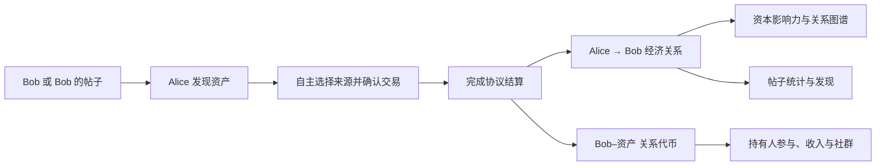

# MoonShip

**展示人的资本影响力与人与人经济关系的链上开放网络；用资本发现人和信息，并奖励发现力贡献者的开放平台。**

[网页应用](https://app.moonship.online/app/) · [English](README.md)

当前客户端包括开发分发中的原生 iOS App 和恢复的网页应用。最新只读核对中，
网页入口及现有主网／测试网服务可访问。App Store 发布与更广泛用户验收另计，
独立插件仍已退役。

## 当前进展｜2026 年 10 月 25 日

首页加载维护已上线，只读检查观察到响应改善；手机端仍待用户验收。

- 移动现货交易已简化为一次原生确认，分别显示到账、网络最终确认与协议结算。一笔小额真实现货订单已完成到账和结算；这是工程验收证据，不代表市场增长已获验证。
- 资金推荐与聊天后端修复已上线；资料加载、关系代币和关系网络展示有进一步本地优化，多用户验收另行记录。
- 新版发行规则已在私有实现中完成改造，通过定向检查与迁移演练；链上激活、最终确认及托管迁移已核对，现有收费及历史收入领取路径保留。
- 原生永续交易与独立费用组件沿用已记录的发布阶段；新增的一体化资金通道属于本地实现，目前公开配置尚未启用。
- 开发包已在本机连接的设备安装。外部测试分发、完整的用户入金／退出／聊天验收及独立安全审阅，不能由上述进展推定完成。

详见[按日期记录的更新](UPDATES.md)与[实现状态](docs/IMPLEMENTATION_STATUS.md)。产品讨论中的收费或发行设想，仅在明确记录激活后才属于线上规则。

> **公开仓库范围说明｜2026 年 10 月 17 日**
>
> **MoonShip 的核心功能已经实现。出于隐私、敏感运营信息和项目知识产权保护的考虑，核心实现已转入私有仓库 [MoonShipLab](https://github.com/Conor-711/MoonShipLab)。本公开仓库仅展示部分内容：项目介绍、实现状态、图示、品牌素材及精选 UI 展示层源码，不包含完整协议和应用实现。**
>
> 下文标记「已实现／源码私有」的功能，对应私有代码库中的实际实现；公开仓库中省略相关源码，不表示该功能仍停留在计划阶段。实现说明属于维护者声明，独立源码审阅与安全审计须另行进行。

[项目更新 / Development updates](UPDATES.md)

## 项目是什么

1. 一个展示人的资本影响力，以及展示人与人之间经济关系的链上开放式网络。
2. 一个用资本去发现人和信息，并且人也能因为贡献发现力而被奖励的开放式平台。

最简单的原语是：**Alice 选择 Bob 作为交易来源，完成一笔资产交易，从而形成 Alice 与 Bob 的经济关系。**

帖子是作者经济关系的子集。从帖子或作者进入，沿用同一主体归因与关系代币流程，帖子额外保留自己的成交统计。来源选择记录交易者的主动声明。

## 当前已实现范围

| 模块 | 已实现内容 | 公开范围 |
| --- | --- | --- |
| 协议 | 主体身份、归因交易结算、经济关系记录、关系代币、实收费用账本 | 文字说明，核心源码私有 |
| iOS 客户端 | 原生资料、信息流、持仓、钱包及收入视图，已接入协议并安装兼容开发构建 | 文字说明，客户端源码私有 |
| 网页应用 | 已恢复与 iOS 并行，网页入口可访问；托管可用与用户流程验收分别记录 | 文字说明，完整源码私有 |
| 历史 X 插件 | 独立目标已退役，保留部分展示层摘录作为历史参考 | 历史 UI 图标与样式 |
| 发现 | 资本驱动原生／已结算 X 信息流、帖子交易者、人物／观点榜和作者归档 | 文字说明，应用与索引源码私有 |
| 关系权益 | 私聊、按数量或持仓排名开放的群组与持有人专属交易机会 | 文字说明，权限和服务实现私有 |
| 环境 | 已配置 Monad／Ethereum 路径、新增 EVM 链的已登记资产交易与独立测试环境 | 部署与运营实现私有 |

详见[实现状态](docs/IMPLEMENTATION_STATUS.md)、[产品概览](docs/PRODUCT_OVERVIEW.md)与[源码范围](SOURCE_SCOPE.md)。

## 给评审者的说明

当前 iOS App 通过开发方式分发。如需审阅完整实现，可通过已有参赛或合作联系渠道向项目所有者申请私有源码权限；获得授权前，私有仓库链接返回 404 属于正常访问限制。

本仓库有意保留部分内容，无法独立构建完整 MoonShip；这里没有用占位合约、虚构后端或演示数据冒充真实实现。实现、线上可用、真实用户验收和独立审计是不同的核验范围。本说明不宣称未经证实的外部用户数、收入、融资或保证收益。
